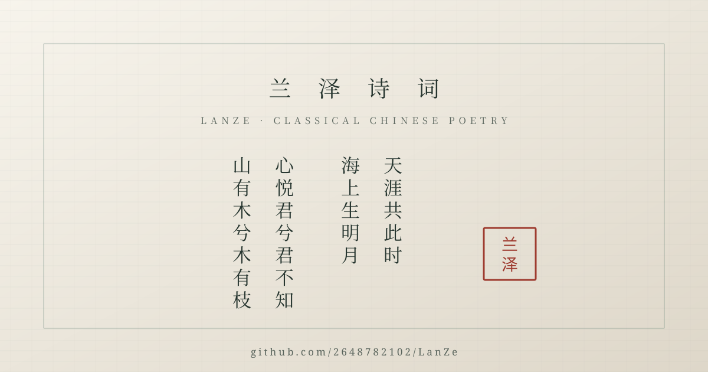

# 兰泽诗词 · LanZe

<p align="center">
  
</p>

<p align="center">
  <a href="LICENSE"></a>
  <a href="https://github.com/2648782102/LanZe/actions/workflows/ci.yml"></a>
  <a href="https://github.com/2648782102/LanZe/actions/workflows/browser-e2e.yml"></a>
  <a href="https://vuejs.org/"></a>
  <a href="CHANGELOG.md"></a>
  <a href="https://github.com/2648782102/LanZe/releases/tag/v0.4.0"></a>
</p>

> **English summary:** LanZe is a community-maintained Vue 3 frontend for reading, browsing and sharing classical Chinese poetry. It runs locally with built-in demo data, includes documentation, CI and tests, and does not promise a verified public demo or hosted account backend.

**简体中文**｜[English summary](#english-summary-1)

> **30 秒阅读**：[快速开始](#快速开始) · [当前状态](#当前状态-2026-11-07) · [环境变量](#环境变量) · [贡献](#贡献)。本地运行只需 `npm ci && npm run dev`；默认使用演示数据，GitHub Pages 仅提供静态前端预览，不承诺账号后端或完整线上 Demo。

## 项目定位

兰泽诗词始于 2022 年，最初是一个以 Vue 3 + Vite 构建的古诗词学习与交流界面：今日读诗、诗词索引、搜索、收藏、创作与本地演示音源。2026 年重新整理后，本仓库的定位是：

1. **可本地运行的开源前端**：`npm ci` → `npm run dev`，无需依赖历史托管平台即可查看界面。
2. **可替换的数据适配层**：`VITE_API_BASE_URL` 优先连接自建 API；未配置或失败时自动降级到仓库内演示数据。
3. **对新人友好的中文开源项目**：提供清晰的贡献、行为、安全、部署和发布文档，而不是只留下一份旧 README。

这不是一个已经上线运营的诗词社区，也不提供线上账号服务、数据库或正式内容审核。仓库 Website 当前指向已验证的 [GitHub Pages 静态预览](https://2648782102.github.io/LanZe/)；该页面只发布前端，不代表托管后端或完整线上 Demo。旧 README 中的 MemFire Cloud 展示地址和 README/代码里的若干 Vercel 地址均属**历史链接**，请不要把它们当作当前可用服务。没有后端时，页面使用本地演示数据；演示账号与作品仅保存在当前浏览器 `localStorage`。

## 当前状态（2026-11-07）

| 项目 | 状态 |
| --- | --- |
| 历史基线 | 原 `main` 停在 `b4ea7f4`（2024-08-18）；2026-11-06 起进行现代化维护 |
| 前端构建 | Vue 3 + Vue Router 4（hash 模式）+ 自有组件 + Vite 6（ESM 配置） |
| 静态预览 | GitHub Pages 项目站点已启用并验证入口资源；仅发布前端，不承诺托管后端、账号服务或正式线上 Demo |
| 后端/账号 | 仓库不附带完整后端；默认使用本地演示数据，配置 `VITE_API_BASE_URL` 后可连接自建 API |
| 测试 | `npm run test` 含 39 个 `node --test` 单测；Node 20/22 CI 与独立 Browser E2E workflow 覆盖构建与主要演示链路 |
| 许可 | [MIT](LICENSE)，`Copyright (c) 2022-2026 LanZe contributors` |
| 发布 | `v0.2.0` / `v0.3.0` 是历史 Release；`v0.4.0` 说明见 `RELEASE_NOTES.md` 与 `ANNOUNCEMENT.md` |
| 设计契约 | [青瓷数字诗馆](docs/DESIGN_SYSTEM.md)：冷白瓷面、青灰线框、铜金索引色与「一首诗一展厅」的信息架构 |

## 主要特性

- 📜 **今日展厅**：整首读诗、词牌长题分行、换诗、收藏态、朗读、按旧版样式等比还原的单张余韵摘录卡与详情页入口。
- 🏛 **诗词索引**：9,350 篇离线馆藏，按朝代、体裁、诗名、作者或字句检索；分卷按需加载，结果分页。
- 🔎 **读诗详情**：居中诗笺、标签、笺注、相关诗目与朗读/复制链接。
- ✍️ **写作台**：本地草稿、实时预览、资料编辑与作品发布；登录状态由浏览器本地存储支持。
- 👤 **我的诗卷**：收藏、最近读过与本机作品三类内容，空状态给出下一步。
- 🎵 **本地声景**：默认提供三段三段 CC BY 3.0 开源古筝录音节选（各 36 秒），含封面、播放列表、切轨、进度拖动、音量/静音与本机偏好记忆；进入页面时收起且不自动播放，显式展开后才呈现完整声景卷，仍可通过公开配置接入授权明确的自定义音源。
- 📱 **响应式布局**：覆盖桌面与 320px 起移动宽度；窄屏筛选折叠、底部导航与默认收起且不播放的吸底播放器分别避让，仍需持续无障碍/视觉回归。
- 🧩 **现代前端栈**：Vue 3、Vue Router 4、原生 `fetch` / Cookie API，配合 Vite 6 构建与 41 项单测。
- 📚 **开源治理**：MIT、贡献/行为/安全政策、变更日志、CI、issue/PR 模板、发布与宣发文案。

「特性」描述的是仓库中已有界面与默认演示数据能力，不等于提供线上账号、持久化服务或正式内容审核。逐项可信度见 `docs/FAQ.md`。

## 技术栈

| 层次 | 当前实现 |
| --- | --- |
| 视图 | Vue 3、Vue Router 4（当前 hash history）、仓库自有 Vue 组件 |
| 构建 | Vite 6 + `@vitejs/plugin-vue`，`package.json` 使用 `"type": "module"`，`base: './'` |
| 语言 | JavaScript / Vue SFC；npm 脚本使用 `node --test` 与 ESM |
| 数据 | `src/data/poetryCatalog.js` 统一离线馆藏读取，`public/data/poetry/` 提供 16 个静态分卷；`src/apis/request.js` 仍用于可选自建 API |
| 动效与媒体 | 浏览器原生音频、CSS/SVG 图标与 `public/media/` 三段 CC BY 3.0 古筝节选/原创 SVG 封面 |
| 样式 | `src/styles/base.css` 设计 token、组件内 CSS 与 `src/components/` 自有组件 |
| 字体与素材 | WOFF2 字体子集与压缩展品图；派生来源与授权审查见 `docs/THIRD_PARTY_ASSETS.md` |
| 设计系统 | `src/styles/base.css` 与 `docs/DESIGN_SYSTEM.md`；组件、状态与响应式规则集中定义 |
| 工具链 | npm、Node.js 20/22、GitHub Actions、`npm run test`、`npm run lint`、浏览器 CDP 冒烟 |
| 部署 | `vite build` 产物，可部署到 GitHub Pages / Vercel / Netlify 等静态托管 |

## 快速开始

### 环境要求

- Node.js **20 或 22**（CI 矩阵同款）；较新的 Node 24 本地可能可用，但不作为最低承诺。
- npm（随 Node 分发）；仓库使用 `package-lock.json`，优先 `npm ci`。
- 现代浏览器；首次启动若依赖预构建较慢，请等待 Vite 输出本地地址。
- 可选：一个兼容项目 API 契约的自建后端，或使用演示数据/mock 模式。

### 安装与运行

```bash
git clone https://github.com/2648782102/LanZe.git
cd LanZe
npm ci
npm run dev
```

打开终端输出的地址（默认 `http://127.0.0.1:5173/`；端口被占用时以 Vite 输出为准）。

### 构建、测试与预览

```bash
npm run build        # 生成 dist/
npm run test         # 39 个 node --test 单测
npm run lint         # 静态检查：失效后端地址、硬编码服务与脆弱引用
npm run preview      # 预览 dist/
npm run smoke        # 预览服务与入口静态资源 HTTP 冒烟
npm run smoke:browser # Chrome / Chromium 桌面、窄屏、登录与发布冒烟
```

CI workflow 在 Node 20/22 执行 `npm ci && npm run build && npm run test --if-present && npm run smoke`，Documentation checks 另执行 `npm run lint`；独立的 Browser E2E workflow 在 Ubuntu 安装 Chromium 后执行 `npm run smoke:browser`。该 CDP 冒烟用独立临时 profile 验证今日展厅、单张摘录卡、桌面/390px/320px 搜索与布局、窄屏筛选折叠、访客草稿、响应式导航、本地收藏、演示登录、作品发布、吸底音源、控制台/网络错误与布局位移预算；本机可用 `CHROME_PATH` 覆盖 Chrome / Chromium 路径。它不覆盖真实后端、跨浏览器矩阵或视觉截图回归。

### 本地演示 / mock 模式

当前版本已实现数据来源切换和无需联网账号的演示数据：

- `VITE_USE_MOCK=true`：显式使用仓库内演示数据，跳过外部 API 请求。
- `VITE_USE_MOCK=false` 且配置 `VITE_API_BASE_URL`：优先调用自建 API；失败或返回无效数据时自动降级并给出一次提示。
- 未配置 `VITE_API_BASE_URL` 时默认启用演示数据；演示账号为 `demo / lanze2026`。

演示账号、注册账号和发布的作品仅写入当前浏览器 `localStorage`，不提供真实密码安全、跨设备同步或线上账号服务。细节见 `docs/DEVELOPMENT.md`。

## 环境变量

前端只放公开配置。所有 `VITE_` 变量都会被构建进浏览器产物，**不得**放服务端密钥、数据库口令、`service_role`、私人令牌或用户数据。

| 变量 | 必填 | 示例 | 说明 |
| --- | --- | --- | --- |
| `VITE_API_BASE_URL` | 否 | `/api/` | 业务 API 前缀；运行时自动补全末尾斜杠。生产环境建议使用同源 `/api/`，由托管平台反向代理 |
| `VITE_API_TIMEOUT` | 否 | `4000` | 远端请求超时（毫秒） |
| `VITE_USE_MOCK` | 否 | `true` | 未配置 API 时自动为 `true`；显式关闭后才会请求远端 |
| `VITE_POETRY_SOURCE` | 否 | `local` | 首页摘录卡默认只用仓库内置摘录；设为 `remote` / `jinrishici` 时才请求外部诗句服务 |
| `VITE_POETRY_SOURCE_URL` | 否 | `https://v1.jinrishici.com/all.json` | 兼容 `content` / `origin` / `author` / `category` 字段的随机诗句接口，可替换为自建服务 |
| `VITE_POETRY_SOURCE_TIMEOUT` | 否 | `4000` | 诗句源超时（毫秒）；失败或超时会回退内置摘录并显示来源状态 |
| `VITE_AUDIO_SOURCE` | 否 | `local` | `local` 使用 CC BY 3.0 古筝节选；仅在确认授权后设置为 `custom` |
| `VITE_AUDIO_TRACKS` | 否 | JSON 数组 | `custom` 模式下的音轨列表；每项至少含 `url`，可选 `name`、`artist`、`cover` |

默认情况下播放器只请求 `public/media/` 内的三段古筝节选，不加载第三方音乐或封面。曲库由 `npm run audio:generate` 从已核验授权的源文件裁切生成，`npm run audio:verify` 校验 WAV 头、时长、清单与 SHA-256；当前音轨为「空山 · 松风」「月色 · 瓷盏」「晚舟 · 水纹」。若设置为 `VITE_AUDIO_SOURCE=custom`，`VITE_AUDIO_TRACKS` 必须是 JSON 数组，例如：

```dotenv
VITE_AUDIO_SOURCE=custom
VITE_AUDIO_TRACKS=[{"name":"示例","artist":"作者","url":"/media/example.mp3","cover":"/media/example.svg"}]
```

音源与封面的版权、可用性、防盗链与隐私政策由配置者自行负责；配置缺失或 JSON 无效时自动回退到本地声景并显示一次可读提示，URL 不可达或播放失败时播放器会显示「声景不可达」并允许重试。`VITE_` 变量会进入浏览器产物，不要填入私密地址或凭据。

若只想在本机播放自己合法取得的音频（例如早期版本那几首商业平台曲目的自有文件），可把文件放入 `public/media/private/`，然后运行 `npm run audio:private`。该目录与生成的 `.env.local.audio` 均被 `.gitignore` 忽略，不进入 Git、不参与构建产物分发；脚本只读取本地文件并启动 `vite --mode local.audio`。仓库默认音轨与线上 Pages 仍使用已署名的 CC BY 3.0 古筝节选。请勿把无授权的商业录音提交进仓库或部署到公开站点。

首页摘录卡默认只使用 `src/data/poems.js` 的内置摘录与精校馆藏短句，不发起外部请求；业务诗库来自 `public/data/poetry/` 的离线分卷。仅当显式设置 `VITE_POETRY_SOURCE=remote` 时才请求 `VITE_POETRY_SOURCE_URL`；接口失败、超时、返回空内容或重复当前诗句会自动回退本地摘录，并在页面标注来源。该服务不由本仓库托管，也不承诺 SLA；部署者可换成自建兼容接口。摘录收藏按诗句内容保存在当前浏览器，不依赖随机接口返回的标识。

可创建 `.env.local`（已被 `.gitignore` 忽略）：

```dotenv
VITE_USE_MOCK=true
# 如需连接自建 API，再填写公开地址；不要在这里填写生产密钥
# VITE_API_BASE_URL=/api/
```

配置契约与 `.env.example` 一致；不要把 `.env` 或 `.env.local` 提交到仓库。

## 项目结构

```text
LanZe/
├── .github/                 # CI、Browser E2E、Pages、发布 workflow 与模板
├── docs/                    # 架构、开发、部署、路线图、FAQ、素材、宣发与巡检
├── public/                  # favicon、SVG/PNG 展示素材与三段古筝节选/封面
├── src/
│   ├── apis/                # 原生 fetch 请求封装与业务 API 列表
│   ├── assets/              # WOFF2 字体子集与压缩展品图
│   ├── components/          # 展馆壳层、图标、列表行与自有反馈组件
│   ├── composables/         # 会话、诗库与通知状态
│   ├── config/              # 运行时环境变量解析
│   ├── data/                # 精校短章、馆藏索引与演示用户
│   ├── public/data/poetry/  # 离线馆藏分卷、目录、校验清单与上游 MIT 许可证
│   ├── router/              # 三段式路由与旧 URL 重定向
│   ├── services/            # 演示数据 API 与浏览器存储
│   ├── styles/              # 设计 token、全局基础样式
│   ├── utils/               # 响应归一化、查询解析、lint 与单测
│   ├── views/               # 今日展厅、寻诗、读诗、诗卷、写作台、登录
│   ├── App.vue              # 根组件
│   └── main.js              # 应用入口与全局插件
├── index.html               # Vite HTML 入口（本地 favicon 与全局样式）
├── vite.config.js           # ESM 构建配置（base './'）
├── package.json             # npm 脚本与依赖
├── README.md                # 本文件
├── docs/THIRD_PARTY_ASSETS.md # 第三方素材与外链来源清单（授权待核验）
├── CONTRIBUTING.md          # 贡献指南
├── CODE_OF_CONDUCT.md       # 行为准则
├── SECURITY.md              # 安全政策
├── CHANGELOG.md             # 变更日志
├── LICENSE                  # MIT
├── RELEASE_NOTES.md         # 当前 Release notes
├── ANNOUNCEMENT.md          # GitHub Discussions 欢迎帖当前文案
└── SOCIAL_POSTS.md          # 中英文宣发短帖素材
```

信息架构以 `src/router/index.js` 与 `docs/DESIGN_SYSTEM.md` 为准；旧版路由保留为兼容重定向，不再对应独立的旧页面。

## 演示与截图

`public/og-image.svg` 与 `public/og-image.png` 是按当前青瓷数字诗馆设计绘制的展示插画，不是运行截图；`public/og-image.png` 已上传为 GitHub Social preview 并回读公开 `og:image`，上传与更新步骤见 `docs/PROMOTION.md`。当前界面的可复核预览请运行 `npm run dev` 或 `npm run preview`。

本地演示建议录屏脚本：

1. `npm ci && npm run dev`，等待页面出现在浏览器。
2. 打开今日展厅，展示整首诗、单张历史样式余韵摘录卡、换诗与换一句摘录。
3. 进入诗词索引、详情页、我的诗卷与写作台，展示响应式布局。
4. 在窄屏或浏览器设备模拟器中重复首页与底部导航。
5. 回到终端运行 `npm run build && npm run test && npm run lint`，展示可复现构建与检查。

GitHub Pages 静态预览可作为当前构建的页面入口，但不要写成官方线上 Demo、账号服务或正式运营社区；历史地址仅作为迁移背景记录。

## 部署

`npm run build` 产出静态文件 `dist/`。当前项目使用 hash history，因此不需要为每条子路由配置 history fallback；若未来切换到 history 模式，托管平台必须把未知路径回退到 `index.html`。

| 平台 | 构建命令 | 发布目录 | 关键配置 |
| --- | --- | --- | --- |
| GitHub Pages | `npm ci && npm run build` | `dist` | 使用 `.github/workflows/pages.yml`，`main` push 自动部署并保留手动 workflow；GitHub Actions 来源已启用，`base: './'` 与静态资源路径已实测，不部署到历史失效域名 |
| Vercel | `npm run build` | `dist` | Framework: Vite；用环境变量或 rewrites 配置 `/api/`；不要沿用历史 Vercel 函数域名 |
| Netlify | `npm run build` | `dist` | Publish directory `dist`；用 redirects/proxy 指向自建 API；设置公开 `VITE_` 变量 |
| 任意静态服务器 | `npm run build` | `dist` | 用 HTTPS 托管静态文件；后端同源代理或显式配置 CORS |

完整步骤、环境变量与回滚建议见 `docs/DEPLOYMENT.md`。静态部署只发布前端；未配置 API 时会自动使用浏览器本地演示数据，不会产生跨设备账号或作品同步。

## 路线图

简要版本（完整优先级与验收标准见 `docs/ROADMAP.md`）：

- **v0.2.0（已发布）**：Vite 6、本地演示数据、23 项单测、lint、README/许可证/治理文档、CI、模板、发布与宣发文案。
- **v0.3.0（已发布）**：按「青瓷数字诗馆」目标模式完全重构信息架构与视图层；移除旧 UI 套件，保留单张历史样式摘录卡，收敛静态素材与布局位移，加入 27 项单测、CI Browser E2E 和音源不可达状态。
- **v0.4.0（当前版本）**：9,350 篇离线馆藏、移动端走查与三段开放授权古筝节选；41 项单测和 CI 浏览器回归覆盖主要演示链路。
- **v0.4.x（后续）**：跨浏览器/视觉回归、素材授权核验、演示录屏、可选后端契约与内容版本依据。
- **后续（社区化）**：按真实贡献推进 i18n、内容版本依据与社区讨论，不预设交付期限。

路线图是公开计划，不是交付期限或商业承诺。

## 贡献

欢迎文档、设计、前端、测试、诗词内容与开源治理方向的贡献。请先阅读：

- [贡献指南](CONTRIBUTING.md)：环境、验证清单、PR 规范
- [行为准则](CODE_OF_CONDUCT.md)：协作约定
- [安全政策](SECURITY.md)：私密报告流程与已知风险
- [设计系统](docs/DESIGN_SYSTEM.md)：目标模式、视觉 token 与页面契约
- [开发文档](docs/DEVELOPMENT.md)：变量、QA、常见故障
- [架构文档](docs/ARCHITECTURE.md)：边界、数据流与迁移方向

最简单的一次贡献：修正一处文档与源码不一致的地方，并在 `CHANGELOG.md` 的 `Unreleased` 区留下一行。

## 许可证

本项目采用 [MIT License](LICENSE)，`Copyright (c) 2022-2026 LanZe contributors`。这不自动覆盖 `src/assets/` 内第三方字体/图片、自定义音源配置、上游 npm 包中的字体/图标或诗词文本可能适用的独立授权；二次发布与商用前请自行核查来源，详见 `docs/THIRD_PARTY_ASSETS.md` 与 `docs/FAQ.md`。

## 致谢

- 感谢 2022–2024 年间的原作者与早期贡献者留下的界面、素材、路由和 `git` 历史。
- 感谢 Vue.js、Vite 等开源项目及其维护者；默认声景与封面由本仓库脚本生成，馆内图像与历史素材来源仍在核验。
- 感谢所有通过 issue、Discussion、PR、文档勘误与本地验证参与社区维护的人。
- 第三方诗词/音乐/字体服务与上游 npm 包仅按实际用途被提及，不代表其运营方或作者与本仓库有隶属或背书关系。

## English summary

LanZe (兰泽诗词) is a Chinese-language, community-maintained Vue 3 frontend for exploring classical Chinese poetry. It began in 2022 and was reorganised in 2026 around a modest goal: make the repository installable, buildable, testable, documented and easy to contribute to.

```bash
npm ci
npm run dev
npm run build
npm run test
npm run lint
npm run smoke
```

The app is now organised as a compact digital poetry museum: a daily reading room, a searchable offline collection of 9,350 poems, poem sheets, a personal collection, a writing desk and a local demo login. It uses Vite 6, 39 unit tests, an independent Vue component system, three reproducible local soundscapes, a Chromium CDP smoke in CI and a configurable API layer: `VITE_API_BASE_URL` takes priority when configured, with automatic fallback to demo data. A verified GitHub Pages site provides a static frontend preview, but no hosted backend, account service or commercial support is promised; historical MemFire/Vercel links should be treated as migration context only. The code is MIT-licensed to `2022-2026 LanZe contributors`; third-party assets may have separate terms. See `docs/DESIGN_SYSTEM.md`, `CONTRIBUTING.md`, `docs/DEVELOPMENT.md` and `docs/ROADMAP.md` before opening a PR.
